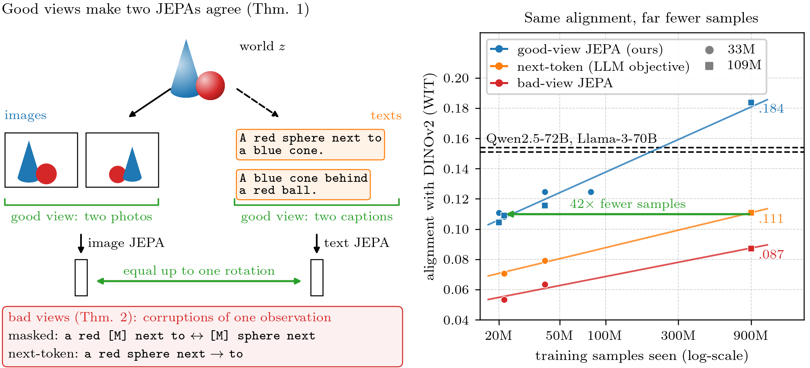
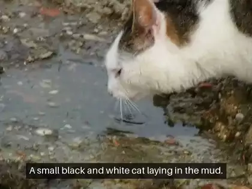

<h1 align="center">Proving and Improving the Platonic Representation Hypothesis with JEPAs</h1>

<p align="center">
Randall Balestriero · Yann LeCun
<br>
<a href="https://huggingface.co/spaces/galilai-group/prh_demo"><b>Live demo</b></a> ·
<a href="docs/reproduce.md"><b>Reproduce every number</b></a>
</p>

Two encoders trained **separately**, one per modality, with a JEPA objective learn **the same embedding up to one
rotation** when their positive pairs are two observations of the same world state (*good views*: two captions of
one image, two photos of one scene). The theorem holds for any modality and any number of them. When the positives
are corruptions of one observation (*bad views*: masked spans, crops), alignment is bounded by how much the
modalities' positive-pair kernels differ; next-token prediction is such a bad-view JEPA.



<table>
<tr>
<td width="33%"></td>
<td width="33%"></td>
<td width="33%"></td>
</tr>
</table>
<p align="center"><sub>Captions by a captioner for which no network was ever trained on an image–caption pair: frozen DINOv2 and DINOv3
image encoders, one rotation, and a language model fine-tuned on text alone, with a new caption each time the scene
changes (<a href="https://huggingface.co/spaces/galilai-group/prh_demo">try it on your own photos and videos</a>).
Videos from Wikimedia Commons, public domain or CC0.</sub></p>

This repository holds the theory as executable checks, every training run (all on
[stable-pretraining](https://github.com/galilai-group/stable-pretraining)), the evaluation, and an image and video
captioner for which no network is ever trained on an image–caption pair.

## Results

| | |
|---|---|
| Good views vs next-token prediction, same 109M encoder and corpus | the same alignment with DINOv2 with **42× fewer samples** (21.6M against 900M) |
| 109M text JEPA on the alt-texts and LLaVA recaptions of 940M web images, the PRH paper's own benchmark (WIT-1024) | **.184** with DINOv2-B (three seeds; a fourth seed at twice the SIGReg weight reaches .121, see the paper), above every language model we tested up to 72B (Qwen2.5-72B .154, Llama-3-70B .151) and CLIP's text encoder (.124) |
| Same encoder against CLIP's image encoders, where language models align best in the PRH paper (WIT-1024) | **.230** with CLIP ViT-H (three seeds, .227–.233), above every language model we tested (Qwen2.5-72B .210, Llama-3-70B .206); also ahead with CLIP ViT-B and ViT-L |
| Same encoder on COCO-5k, a second benchmark | **.161** (Llama-3-70B .113, Qwen2.5-72B .108, CLIP's text encoder .132, all-mpnet-base-v2 .156) |
| A scaling law of alignment in the fraction of good views and the samples seen | predictions registered before training 85 new runs: RMSE **.0093**, as close as rerunning a run with another seed (.0096) |
| Alignment with **no pair at all** (benchmark and code of [Schnaus et al.](https://arxiv.org/abs/2610.09411), DINOv2-B, COCO 2014) | zero-shot CIFAR-10 **86.0**, CIFAR-100 **67.2**, ImageNet-100 **64.4**, above every accuracy of their paper over 21 vision–language pairs and five settings (82 / 62 / 56); FOSCTTM **.018**, level with their best on the same data (.02) |
| Captioner: frozen DINOv2 + DINOv3 → one rotation → a language model fine-tuned on text only | CIDEr **.838** on COCO; **.246** on MSR-VTT videos from their frames, above zero-shot captioners whose decoder saw only image captions or general text |

## Installation

Linux, Python ≥ 3.11 and PyTorch ≥ 2.6. The tests run on CPU; training needs CUDA GPUs.

```bash
git clone https://github.com/galilai-group/prh-proof && cd prh-proof
python -m venv .venv && source .venv/bin/activate      # or: conda create -n prh python=3.11
pip install torch --index-url https://download.pytorch.org/whl/cu124   # the build that matches your CUDA
pip install -e ".[dev]"                                 # also installs stable-pretraining from GitHub
pytest -m "not slow"                                    # every theorem and every component, ~2 min on CPU
```

| extra | for | |
|---|---|---|
| `.[video]` | extracting MSR-VTT frames | decord, OpenCV |
| `.[pairfree]` | alignment without pairs (Schnaus et al.'s method) | their library, pinned |

Pretrained models (DINOv2, DINOv3, Qwen2.5, and the language models we compare to) download from the Hugging Face
Hub on first use. DINOv3's weights are gated: accept their license on the Hub and `hf auth login` first.

## Data

Everything is read from `data/<name>`, a folder or a symbolic link to an existing copy; [`docs/data.md`](docs/data.md)
gives every download command and the expected layouts.

| needed for | dataset | size |
|---|---|---|
| quick start, every Flickr experiment | Flickr30k (Karpathy split) | 8 GB |
| COCO experiments and the captioner | COCO Karpathy captions (`python -m prh.data`), COCO-5k test images | 1.6 GB |
| scaling the text side | Recap-DataComp-1B texts (alt-text and two recaptions per web image) | up to 492 GB (4,627 files of 203k images; `--data recaptext:<n>` reads the first `n`) |
| image JEPAs on web images | Recap-DataComp-1B images, fetched from their URLs | up to 28 TB |
| video | MSR-VTT, and 8 frames per clip (`python -m prh.data frames`) | 6.3 GB + 1.9 GB |
| the PRH benchmark | WIT-1024 of [Huh et al.](https://github.com/minyoungg/platonic-rep) | downloaded automatically |
| image JEPAs on ImageNet | ImageNet-1k | 150 GB |

## Quick start: two JEPAs on Flickr30k, one GPU, about two hours

```bash
python -m prh.data                                                  # small text-only tables (COCO captions, STS-B)
python evaluate.py embed dinov2 runs/ref/flickr_dinov2              # frozen DINOv2 ViT-B/14 on the Flickr val+test images
python train.py --modality text --caption-views                     # good-view text JEPA, ~1 GPU-hour; drop the flag for bad views
python evaluate.py align runs/ref/flickr_dinov2 runs/runs/<text run>          # expect R@1 ≈ .25 (bad-view JEPA ≈ .13, next-token ≈ .12)
python train.py --modality image                                    # an image JEPA from scratch, ~2 GPU-hours
python evaluate.py align runs/runs/<image run> runs/runs/<text run>           # expect R@1 ≈ .044 (bad .027, next-token .021)
```

Each run writes `runs/runs/<date>/<time>/<id>/` (checkpoints, validation embeddings); `align` fits one rotation on
the 1,014 validation pairs and retrieves among the 1,000 test captions (chance .001). `submit.sh` runs any
`train.py` command under SLURM with preemption-safe requeue (`sbatch -J <name> submit.sh <arguments>`; adapt its
partition and account lines).

## Reproducing the paper

Every number comes from the runs of one registry, scored and drawn by four scripts:

```
train.py  →  evaluate.py  →  tables.py  →  figures.py
(paper/runs.csv: 345 runs,     (one run's     (tables that gather    (every figure, from
 exact arguments, seeds)        numbers)       many runs: paper/data)  paper/data and prh.theory)
```

[`docs/reproduce.md`](docs/reproduce.md) maps every figure and table to its runs and commands, section by section.
Nothing is selected on test data. The 345 runs took about 5,500 GPU-hours, preemptions included:

| | GPU-hours each |
|---|---|
| a Flickr arm (text or image JEPA, 200 epochs) | 1–2 |
| the scaling-law runs (145 BERT-S runs on Recap texts, 3M–320M samples) | 5 on average |
| BERT-S on the texts of 100M images (80M samples) | 14 |
| BERT-B on the texts of 940M images (900M samples, 8–16 GPUs), per seed and per arm | 200–400 |
| image JEPA, ViT-S on ImageNet-1k (300 epochs, 8 GPUs) | ~200 |

The runs used stable-pretraining at revision `ab836bf`; on its multi-GPU runs, SIGReg's effective weight depends on
the per-GPU batch (see [`docs/reproduce.md`](docs/reproduce.md), Sec. 5).

## Captioning without image–caption pairs

The captioner of the paper is three frozen pieces and one fitted map: DINOv2 and DINOv3 image encoders, a rotation
into the text JEPA's space (the only part fitted on pairs), and a language model fine-tuned on text alone to decode
that space. `caption.py` scores it on Flickr30k and COCO; `python -m prh.captioner` packs it into one portable file and
captions any photo:

```bash
python caption.py --decoder <decode run> --image runs/ref/flickr_gl_all --text runs/ref/all_T --pairs 30014 \
    --beam 1 --samples 32 --out figs/cap_flickr                                  # CIDEr on Flickr30k; writes rotation.pt
python -m prh.captioner --decoder <decode run> --rotation figs/cap_flickr/rotation.pt \
    --image-model dinov2-g+avg,dinov3-l+avg --beam 1 --samples 32 --save captioner.pt
python -m prh.captioner --captioner captioner.pt photo1.jpg photo2.jpg
```

[`docs/reproduce.md`](docs/reproduce.md) (Sec. 7) trains the text JEPA and the decoder of the paper's strongest
captioner. The [live demo](https://huggingface.co/spaces/galilai-group/prh_demo) runs the same captioner on photos
and videos.

## Code

| | |
|---|---|
| `train.py` | the one training entrypoint: wires `prh` into stable-pretraining's `LeJEPA`, `Module`, `Manager` and callbacks |
| `evaluate.py` | embeddings of frozen encoders, alignment through one rotation, the PRH protocol (WIT-1024, COCO), Thm. 3 on real encoders, unimodal checks |
| `caption.py`, `prh/captioner.py` | the captioner on a test set (BLEU-4, CIDEr), and the captioner as one portable bundle that captions any photo |
| `tables.py`, `figures.py` | the tables that gather many runs, and every figure of the paper |
| `paper/` | the paper's figures (`figs/`), `runs.csv` (every run: tag, `train.py` arguments, run directory) and `data/` (every table behind a figure, each row naming its source) |
| `prh/theory.py` | the finite worlds of Sec. 2: positive-pair operators, spectral solutions, the Davis–Kahan bound, world kernels of views and data |
| `prh/views.py`, `prh/forward.py`, `prh/models.py` | good and bad text views; the forward functions of LeJEPA, next-token prediction and caption decoding; the text encoder and the text-only decoders |
| `prh/pairfree.py` | alignment without any pair (Schnaus et al.'s method on our encoders), its scores and seed selection |
| `prh/data.py`, `prh/features.py`, `prh/align.py`, `prh/metrics.py`, `prh/plots.py` | datasets, embeddings, the `Rotation` between two spaces, scores, plotting |
| `tests/` | every statement of Sec. 2 checked numerically, every component, an end-to-end run |

Training and validation loops, optimizers, schedules, checkpointing, SLURM requeue, DDP, multi-crop and LeJEPA's
loss are stable-pretraining's; [`docs/design.md`](docs/design.md) explains each piece of custom code.

## License

The code is released under the [MIT License](LICENSE). Pretrained models and datasets that the code downloads keep
their own licenses.

## Citation

```bibtex
@article{balestriero2026prh,
  title  = {Proving and Improving the Platonic Representation Hypothesis with {JEPAs}},
  author = {Balestriero, Randall and LeCun, Yann},
  year   = {2026}
}
```
